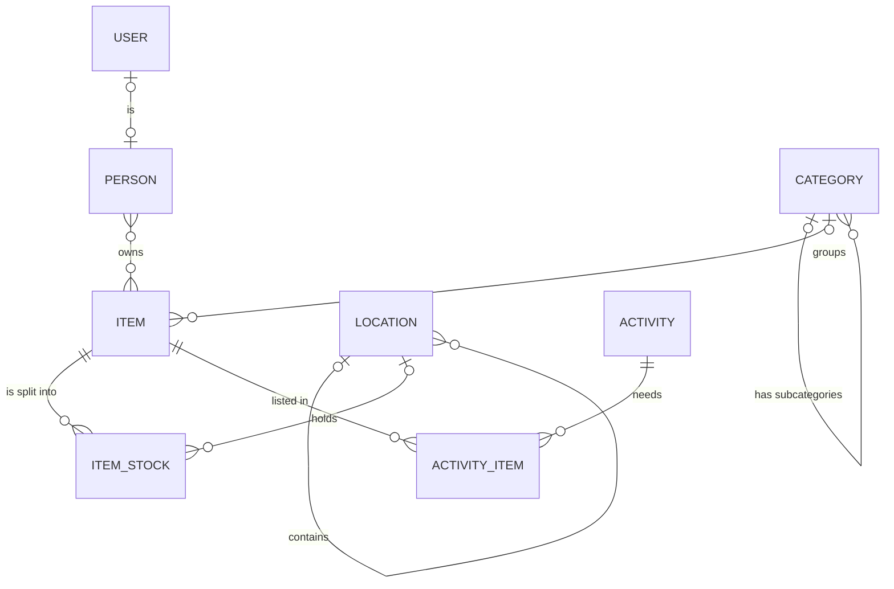
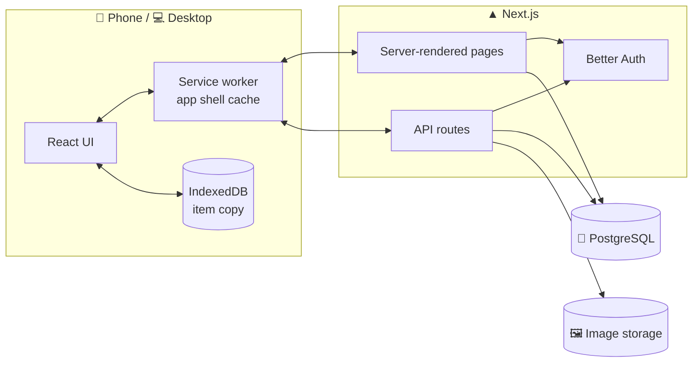
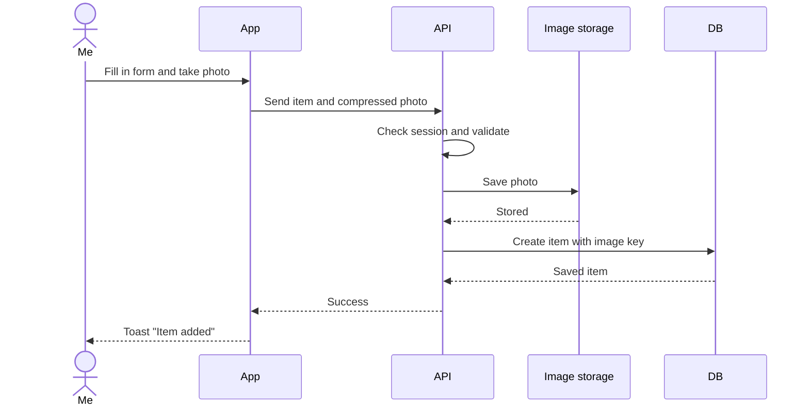

# 🎒 Gear Vault — Project Overview

> Know what you own, where it is, and what to pack.

**Status:** planning · **Last updated:** 26 November 2026

Items marked 💡 are proposals that go beyond the original notes. Accept, change or drop them.

---

## 📌 Contents

1. [Problem](#-problem)
2. [Users](#-users)
3. [Features](#-features)
4. [Data model](#-data-model)
5. [Tech stack](#-tech-stack)
6. [Architecture](#-architecture)
7. [UI / UX](#-ui--ux)
8. [Monetization](#-monetization)
9. [Roadmap](#-roadmap)
10. [Decisions](#-decisions)
11. [Links](#-links)

---

## 🎯 Problem

I own a lot of things and can't keep track of them.

| Pain | What Gear Vault does |
| --- | --- |
| I don't know everything I have | One list of everything I own |
| I spend too long looking for things | Record where each item is, even split across places |
| I forget gear for activities | A list of what each activity needs |

---

## 👥 Users

| Person | Uses the app | Owns items | Notes |
| --- | :---: | :---: | --- |
| **Me** | ✅ | ✅ | The only user for now; this is my vault |
| **Bela** | Later | ✅ | It could help her too |
| **Elanor** | ❌ | ✅ | Many things in the house are hers |

The vault can hold things belonging to someone else, so **an owner does not need an account**. The data model separates `Person` (owns things) from `User` (logs in).

---

## ✨ Features

### MVP

| | Feature | Details |
| :---: | --- | --- |
| 📋 | **Item list** | Browse everything |
| ✏️ | **Item CRUD** | Create, view, update, delete |
| 🗂️ | **Filters** | Category, subcategory, location |
| 🔍 | **Search** | 💡 Name, brand, description |
| 🏷️ | **Item fields** | Name, picture, icon, category, brand, quantity, location |
| 🔢 | **Split quantities** | One item can be spread across several locations |
| 🧗 | **Activity lists** | The things needed for each activity |
| 📚 | **Collections** | View items grouped by category |
| 🔐 | **Authentication** | Email and password |
| 🌙 | **Dark mode** | Default; light mode optional |
| 📱 | **PWA** | Installable, works on mobile and offline |

**Offline scope for v1:** installable PWA; browse, search and filter offline, including activity lists. Adding and editing need a connection.

### After MVP

- 💡 Offline editing with sync
- 💡 Packing mode: tick items off while packing
- 💡 CSV import and export
- 💡 QR labels on boxes that open their contents

**Not planned for now:** access for other users, lending tracking, AI features.

---

## 🗄️ Data model

### Relationships



### Schema draft (DBML)

```dbml
Table gear {
  id integer [pk, increment]
  name varchar(30) [not null]
  category_id integer [ref: > category.id] // category or subcategory
  description varchar(255)
  picture varchar(255)
  icon varchar(30)
  brand varchar(30) // if available
  price decimal(10,2) // or value
  condition condition
  created_at timestamp [not null, default: `now()`]
  updated_at timestamp

  Records (id, brand, name, category_id, condition) {
    1, 'DJI', 'drone mini 5 pro', 3, 'new'
  }
}

Table category {
  id integer [pk, increment]
  name varchar(30) [not null]
  parent_id integer [ref: > category.id] // empty for a top-level category

  Records (id, name, parent_id) {
    1, 'sport', null
    2, 'music', null
    3, 'hightech', null
    4, 'camping', null
    5, 'van', null
    6, 'tool', null
    7, 'lego', null
    8, 'book', null
    9, 'clothing', null
    10, 'screen', 3
    11, 'console', 3
    12, 'surf', 1
    13, 'capoeira', 1
    14, 'crossfit', 1
  }
}

Table location {
  id integer [pk, increment]
  name varchar(30) [not null]
  parent_id integer [ref: > location.id] // e.g. a shelf in the office

  Records (id, name) {
    1, 'office'
    2, 'bedroom'
    3, 'van'
  }
}

Table person {
  id integer [pk, increment]
  name varchar(30) [not null]

  Records (id, name) {
    1, 'tristan'
    2, 'bela'
    3, 'elanor'
  }
}

Table gear_owner {
  gear_id integer [not null, ref: > gear.id]
  person_id integer [not null, ref: > person.id]

  indexes {
    (gear_id, person_id) [pk]
  }

  Records (gear_id, person_id) {
    1, 1
  }
}

// How many of an item are in each place
Table gear_stock {
  id integer [pk, increment]
  gear_id integer [not null, ref: > gear.id]
  location_id integer [ref: > location.id] // empty if not yet known
  quantity integer [not null, default: 1]

  indexes {
    (gear_id, location_id) [unique]
  }

  Records (id, gear_id, location_id, quantity) {
    1, 1, 1, 1
  }
}

Table activity {
  id integer [pk, increment]
  name varchar(30) [not null, unique]
  icon varchar(30)
}

Table activity_gear {
  activity_id integer [not null, ref: > activity.id]
  gear_id integer [not null, ref: > gear.id]
  quantity integer [not null, default: 1]

  indexes {
    (activity_id, gear_id) [pk]
  }
}

enum condition {
  new
  good
  worn
}
```

- Categories, subcategories and locations are rows, so adding one needs no migration.
- Subcategory parents: `screen` and `console` under `hightech`; `surf`, `capoeira` and `crossfit` under `sport`.
- An item can have several owners through `gear_owner`.
- Only `name` has to be filled in. The app creates one `gear_stock` row with quantity 1 and no location.
- An item's total quantity is the sum of its `gear_stock` rows.
- `person` covers people with or without a login. The Prisma version below adds accounts.

### Prisma schema

> ⚠️ **Rough draft, not set in stone.** Written for **Prisma ORM 7** with PostgreSQL. `prisma@latest` now installs [Prisma ORM 8](https://www.prisma.io/changelog), so install with `prisma@7` to use this draft, or port it before starting.

```prisma
generator client {
  provider = "prisma-client"
  output   = "../src/generated/prisma"
}

// In Prisma 7 the connection URL lives in prisma.config.ts
datasource db {
  provider = "postgresql"
}

enum Condition {
  NEW
  GOOD
  WORN
}

// Better Auth also needs Session, Account and Verification models,
// plus extra User fields. Generate them with its CLI.
model User {
  id            String   @id @default(cuid())
  name          String
  email         String   @unique
  emailVerified Boolean  @default(false)
  image         String?
  person        Person?
  createdAt     DateTime @default(now())
  updatedAt     DateTime @updatedAt
}

// Someone who owns things, with or without a login
model Person {
  id     String  @id @default(cuid())
  name   String
  userId String? @unique
  user   User?   @relation(fields: [userId], references: [id], onDelete: SetNull)
  items  Item[]
}

// A top-level category has no parent; a subcategory points to one
model Category {
  id       String     @id @default(cuid())
  name     String
  icon     String? // Lucide icon name
  color    String? // hex
  parentId String?
  parent   Category?  @relation("Subcategories", fields: [parentId], references: [id], onDelete: Restrict)
  children Category[] @relation("Subcategories")
  items    Item[]

  @@unique([parentId, name]) // does not stop duplicate top-level names (NULL parent)
}

// Nestable: Garage > Shelf 2 > Blue box
model Location {
  id       String     @id @default(cuid())
  name     String
  parentId String?
  parent   Location?  @relation("SubLocations", fields: [parentId], references: [id], onDelete: Restrict)
  children Location[] @relation("SubLocations")
  stock    ItemStock[]

  @@index([parentId])
}

model Item {
  id          String     @id @default(cuid())
  name        String
  description String?
  brand       String?
  value       Decimal?   @db.Decimal(10, 2)
  condition   Condition?
  imageKey    String? // object storage key, not the file itself
  icon        String? // overrides the category icon

  categoryId String? // category or subcategory
  category   Category? @relation(fields: [categoryId], references: [id], onDelete: SetNull)

  owners     Person[]
  stock      ItemStock[]
  activities ActivityItem[]

  createdAt DateTime @default(now())
  updatedAt DateTime @updatedAt

  @@index([categoryId])
  @@index([name])
}

// How many of an item are in each place. Total quantity = sum of rows.
model ItemStock {
  id         String    @id @default(cuid())
  itemId     String
  item       Item      @relation(fields: [itemId], references: [id], onDelete: Cascade)
  locationId String? // empty if not yet known
  location   Location? @relation(fields: [locationId], references: [id], onDelete: SetNull)
  quantity   Int       @default(1)

  @@unique([itemId, locationId]) // does not stop duplicate rows with no location
  @@index([locationId])
}

// Activity lists
model Activity {
  id    String         @id @default(cuid())
  name  String         @unique
  icon  String?
  items ActivityItem[]
}

model ActivityItem {
  activityId String
  itemId     String
  quantity   Int      @default(1)
  activity   Activity @relation(fields: [activityId], references: [id], onDelete: Cascade)
  item       Item     @relation(fields: [itemId], references: [id], onDelete: Cascade)

  @@id([activityId, itemId])
  @@index([itemId])
}
```

**Design choices**

- `category` and `subcategory` from the notes become one self-referencing `Category`. Filtering by a parent must include its children.
- `location` is its own nestable model, so renaming a shelf updates every item on it.
- **One vault, one account.** 💡 Disable public sign-up once your account exists.
- Quantity and location live in `ItemStock`, so 6 of something can be 4 in the office and 2 in the van. Filtering by location goes through it.

---

## 🧱 Tech stack

| Layer | Choice | Source |
| --- | --- | --- |
| ⚛️ Framework | [Next.js](https://nextjs.org/docs) (16.x) + [React](https://react.dev) | Notes |
| 🔷 Language | [TypeScript](https://www.typescriptlang.org/docs/) | Notes |
| 🖥️ Rendering | Server-rendered pages with dynamic client components | Notes |
| 🔌 Backend | API routes (items, activities, uploads) | Notes |
| 📦 Repo | Single codebase | Notes |
| 🐘 Database | [PostgreSQL](https://www.postgresql.org/docs/), hosted on [Neon](https://neon.com/docs) | 💡 |
| 🔺 ORM | [Prisma](https://www.prisma.io/docs) | 💡 |
| 🔐 Auth | [Better Auth](https://www.better-auth.com/docs) (email and password) | 💡 |
| 🖼️ Images | [Cloudflare R2](https://developers.cloudflare.com/r2/) | 💡 |
| 🎨 Styling | [Tailwind CSS](https://tailwindcss.com/docs) + [shadcn/ui](https://ui.shadcn.com) | 💡 |
| ✴️ Icons | [Lucide](https://lucide.dev) | 💡 |
| 📱 PWA | [Serwist](https://serwist.pages.dev) | 💡 |
| 💾 Offline data | IndexedDB via [Dexie](https://dexie.org) | 💡 |
| 🚀 Hosting | [Vercel](https://vercel.com/docs) | 💡 |

**Watch out for**

- **SSR and offline pull in different directions.** Server-rendered pages need a server. Offline browsing needs a cached app shell and a local copy of the data. Prototype this first.
- **Serwist and Turbopack:** Next.js builds with Turbopack by default, while the classic `@serwist/next` plugin relies on webpack. Check Serwist's current setup guide before wiring it in.
- **Photos:** resize and compress before upload, and cache thumbnails only for offline use.
- **Security updates:** Next.js ships regular [security releases](https://nextjs.org/blog); stay on a patched version.

---

## 🏗️ Architecture



### Adding an item



### 💡 Suggested routes

| Route | Purpose |
| --- | --- |
| `/sign-in` | Email and password |
| `/` | Collections and items |
| `/items?category=&location=&q=` | Filtered and searched list |
| `/items/[id]` | Item drawer, linkable |
| `/collections/[id]` | One category |
| `/activities` | Activity lists |
| `/api/items`, `/api/items/[id]` | Item CRUD |
| `/api/activities` | Activity list CRUD |
| `/api/uploads` | Picture upload |

---

## 🎨 UI / UX

### Direction

**Ghost Recon Breakpoint feel** on a **clean, minimal base**.

- 🌑 Dark by default, light optional
- 🔤 Clean typography, generous whitespace
- ➖ Subtle borders and shadows
- 🔗 References: [Notion](https://www.notion.com), [Linear](https://linear.app), [Raycast](https://www.raycast.com)
- 💡 Take from the game: an inventory/loadout grid, thin outlined panels, uppercase condensed labels, one sharp accent colour. Use original artwork and icons, not game assets.

### Layout

```text
┌──────────────┬──────────────────────────────────────┬──────────────┐
│ GEAR VAULT   │  🔍 Search…        [Filters]  [+ Add] │              │
│              ├──────────────────────────────────────┤  ITEM DRAWER │
│ CATEGORIES   │  COLLECTIONS                          │              │
│  Camping     │  ┌────────┐ ┌────────┐ ┌────────┐     │  [picture]   │
│  Photo       │  │Camping │ │ Photo  │ │ Tools  │     │  Name        │
│  Tools       │  └────────┘ └────────┘ └────────┘     │  Brand       │
│ ACTIVITIES   │                                       │  Total qty   │
│ LATEST       │  ITEMS                                │  Locations   │
│ COLLECTIONS  │  ┌────────┐ ┌────────┐ ┌────────┐     │  Owners      │
│              │  │  item  │ │  item  │ │  item  │     │  [Edit]      │
└──────────────┴──────────────────────────────────────┴──────────────┘
```

- **Sidebar:** collapsible; categories, latest collections and activities. Becomes a drawer on mobile.
- **Main:** grid of collection cards, with item cards underneath.
- **Colour coding:** collection cards take a background colour from what they mostly hold (💡 the dominant subcategory); item cards take a border colour from their category.
- **Item details:** open in a quick-access drawer.
- **Responsive:** desktop-first, fully usable on mobile.

### 💡 Category colours and icons

The notes listed types such as Snippet, Prompt and Command, which don't fit a gear inventory. Their palette is reused here with example gear categories. Your [schema draft](#schema-draft-dbml) has the real list, which still needs colours and icons.

| Category | Colour | Hex | [Lucide](https://lucide.dev/icons) icon |
| --- | :---: | --- | --- |
| Camping & outdoor | 🔵 | `#3b82f6` | `tent` |
| Photo & video | 🟣 | `#8b5cf6` | `camera` |
| Tools & DIY | 🟠 | `#f97316` | `wrench` |
| Sports | 🟡 | `#fde047` | `dumbbell` |
| Other | ⚪ | `#6b7280` | `package` |
| Clothing | 🩷 | `#ec4899` | `shirt` |
| Electronics | 🟢 | `#10b981` | `cable` |

Show the icon or name alongside the colour, and check yellow's contrast in light mode.

### Micro-interactions

- Smooth transitions
- Hover states on cards (💡 with a visible equivalent for touch and keyboard)
- Toast notifications for actions
- Loading skeletons

---

## 💰 Monetization

**None for now.** Gear Vault is a personal app.

---

## 🗺️ Roadmap

💡 Suggested order:

| Phase | Scope | Done when |
| --- | --- | --- |
| **0. Foundations** | Project setup, database, auth, offline prototype | I can sign in, and a page opens offline |
| **1. Inventory** | Item CRUD, pictures, categories, locations, split quantities | My first box of gear is catalogued |
| **2. Find** | Search, filters, collections | I can locate an item in seconds |
| **3. Activities** | Activity lists | I can see what an activity needs |
| **4. PWA and polish** | Install, offline browsing, theme, skeletons, toasts | It works on my phone without signal |
| **Later** | Offline editing, packing mode, import/export, QR labels | |

---

## ✅ Decisions

| Question | Decision (26 November 2026) |
| --- | --- |
| Activity lists in the MVP? | Yes |
| Who uses the vault? | Only me for now |
| Offline | Read-only is enough; it must be a PWA |
| Split quantities across locations? | Yes |
| Subcategory parents | Confirmed |
| Lending tracking | Not for now |
| AI features | Not for now |
| Personal or SaaS? | Personal for now |

---

## 🔗 Links

- [Next.js PWA guide](https://nextjs.org/docs/app/guides/progressive-web-apps)
- [Prisma documentation](https://www.prisma.io/docs)
- [Better Auth documentation](https://www.better-auth.com/docs)
- [Serwist documentation](https://serwist.pages.dev)
- [MDN: Progressive Web Apps](https://developer.mozilla.org/en-US/docs/Web/Progressive_web_apps)
- [Mermaid syntax](https://mermaid.js.org/intro/)

---

## 📝 Changes from the original notes

- Removed **syntax highlighting for code blocks** and the "developer-focused" wording, which don't fit this app.
- Replaced the snippet-style **item types** with gear categories.
- Dropped the empty **"Document – Docs and context"** heading.
